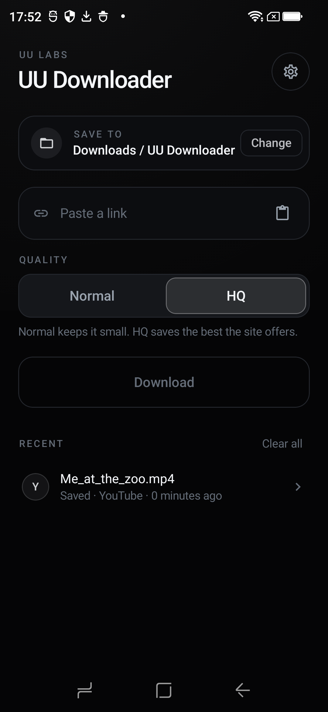
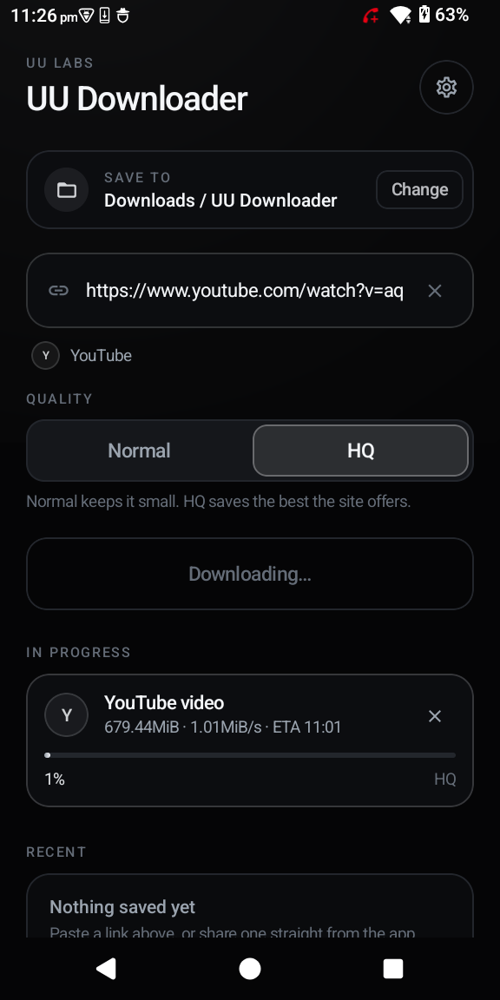
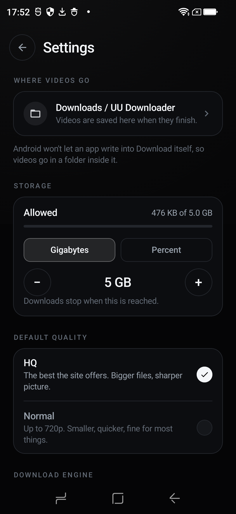

# UU Downloader

An Android app for saving videos from the socials. Share a link from Instagram, TikTok, X,
Facebook, Reddit or YouTube and the download starts in the notification shade; or open the app
and paste one.

| Home | Downloading | Settings |
| --- | --- | --- |
|  |  |  |

## Features

- **Share target.** Accepts shared text links, including the caption-wrapped links Instagram and
  Facebook send, and starts the download without further taps.
- **Paste and download.** One field, one button. The link is validated as you type and the site
  is named as soon as it is recognised.
- **Normal or HQ.** HQ is offered only when the source has something above 720p; if it does not,
  the choice is not shown.
- **No setup required.** Videos are written to `Download/UU Downloader` without a permission
  prompt. Any other folder can be selected through the system picker.
- **Progress you can act on.** A silent foreground notification reports percent, size, speed and
  ETA, with a cancel action. Completed files get their own notification.
- **Storage allowance.** A limit in gigabytes or a percentage of the device, enforced before a
  download starts and while it runs.
- **Update checks for both the app and its engine**, with the engine updatable in place.
- **Optional sign-in.** A `cookies.txt` exported from a browser can be imported for sites that
  refuse anonymous requests. Nothing is signed in by default.

## Supported sources

Anything [yt-dlp](https://github.com/yt-dlp/yt-dlp) supports. The app carries no allow-list, so
a link is passed to the engine and named after its site; YouTube, TikTok, Instagram, Facebook, X
and Reddit are also given their own label in the list.

Adult sites are supported where the engine supports them. The app keeps no catalogue and does
not list them.

Requests go out on the device's own connection. The app runs no proxy, tunnel or VPN of its own,
and never attempts to defeat an access control: when a site refuses a region, demands a sign-in
or refuses a request as automated, the app reports the site's message and stops.

## Installation

| File | For |
| --- | --- |
| `UUDownloader-<version>-arm64.apk` | every phone from roughly 2017 onwards |
| `UUDownloader-<version>-armv7.apk` | older 32-bit devices |
| `UUDownloader-<version>-universal.apk` | both architectures in one file |

```sh
adb install -r UUDownloader-1.5.0-arm64.apk
```

Releases are signed with a dedicated UU Labs key, so a newer build installs over an older one
and keeps its settings. Each release publishes a `SHA256SUMS` file:

```sh
shasum -a 256 -c SHA256SUMS
```

Builds up to 1.3.3 were signed with the Android debug certificate and cannot be updated in
place; uninstall those before installing a current build.

## Updating

**Settings → App updates → Check** compares the installed version with the latest GitHub
release, and the same check runs on launch, at most once an hour. When a newer version exists
the app offers it and opens the release page; the browser downloads the file and Android's
installer takes over.

The app does not download or install APKs itself. That behaviour is what Google Play Protect
classifies as a dropper, and removing it is what keeps the app out of that category.

**Settings → Download engine → Update** fetches the current yt-dlp from its own release feed.
This is independent of app updates and is the first thing to try when a site stops working.

## Build

Requires JDK 17+ and an Android SDK with platform 36.

```sh
./gradlew :app:assembleRelease
# app/build/outputs/apk/release/app-arm64-v8a-release.apk     ~61 MB
# app/build/outputs/apk/release/app-armeabi-v7a-release.apk   ~54 MB
# app/build/outputs/apk/release/app-universal-release.apk     ~104 MB
```

Release signing reads `SigningKeys/keystore.properties`, which is not in the repository. Without
it the build succeeds and warns that the APK is unsigned.

### Size

| Component | Per ABI | Purpose |
| --- | --- | --- |
| ffmpeg | 31–36 MB | muxing separate video and audio streams; required for YouTube above 720p |
| CPython | ~13 MB | the runtime yt-dlp executes on |
| yt-dlp and extractors | ~3 MB | site extraction |
| app and Compose | ~3 MB | the interface |

Per-ABI APKs keep a device from downloading an architecture it will never run. A build without
ffmpeg is available where merge support is not needed:

```sh
./gradlew :app:assembleRelease -PuuFfmpeg=false   # ~40 MB per ABI
```

That build requests single already-muxed files, which is what most sources serve; YouTube is
then limited to its best pre-muxed stream, usually 720p.

### Tests

```sh
./gradlew :app:testDebugUnitTest
```

21 unit tests cover link parsing, quality selection, filename safety, progress parsing, the
storage allowance, and the update version comparison.

## Architecture

Two download engines, selected by the link:

| Link | Engine |
| --- | --- |
| media file (`.mp4`, `.webm`, `.mov`, …) | direct HTTP |
| anything else | yt-dlp on a bundled CPython, via [youtubedl-android](https://github.com/yausername/youtubedl-android) 0.18.1, with its ffmpeg module |

A current yt-dlp is bundled in the APK and installed into the wrapper's directory on first use.
A marker records the installed version, so a bundled copy never replaces a newer engine fetched
with **Update**.

A single foreground service runs the queue; the screen and the notification read the same
in-memory state. Only completed downloads are persisted.

```
app/src/main/kotlin/au/com/uulabs/uudownloader/
  core/        link parsing, quality selection, filenames — no Android dependencies
  data/        preferences, storage allowance, cookie import
  download/    engines, writers, foreground service, notifications
  update/      app and engine update checks
  ui/          Compose screens
icon/          the icon source art and the script that builds every density
docs/          design notes and the screenshots above
```

## Permissions

| Permission | Reason |
| --- | --- |
| `INTERNET`, `ACCESS_NETWORK_STATE` | downloading |
| `POST_NOTIFICATIONS` | progress and completion |
| `FOREGROUND_SERVICE`, `FOREGROUND_SERVICE_DATA_SYNC` | keeping a download alive with the screen off |

No analytics, no crash reporting, no account, no server. Videos are fetched by the device and
saved to the device.

## Troubleshooting

**YouTube reports "sign in to confirm you're not a bot", "The page needs to be reloaded" or a
403.** These are network-level checks aimed at the address, not the video. The app retries as
the `tv`, `web_safari` and `ios` clients before reporting a failure. If all are refused, update
the engine, then import browser cookies if it still fails.

**A message quoting the site** — *"This video is private"*, *"Your IP address is blocked from
accessing this post"*, *"Account authentication is required"* — is the site's own refusal, and
an engine update will not change it.

**A failed download can be read in full.** Tap the row in Recent for the complete message and a
copy button.

## Limitations

- Some posts require a signed-in session (Reddit's video API refuses anonymous clients; Instagram,
  Facebook and X gate some content). Import cookies if you need them.
- Region-blocked and private videos cannot be downloaded, and neither can live streams.
- Quality is whatever the source offers.
- One download runs at a time; further links wait in the queue.

## Licence

`youtubedl-android` is GPL-3.0, which makes this application GPL-3.0 as a whole. Corresponding
source is this repository. yt-dlp is Unlicense; CPython and ffmpeg carry their own licences.

---

UU Labs, 2026.
